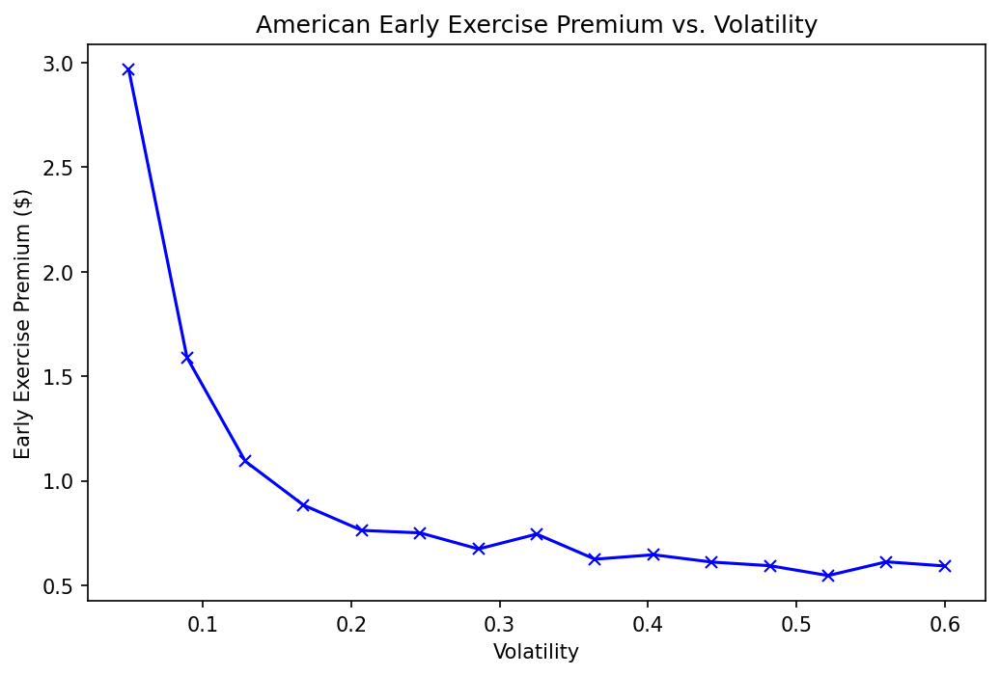

# Monte Carlo Option Pricing Engine

A Python based options pricing program used to verify Monte Carlo Simulation against Black-Scholes pricing. It utilizes antithetic variance reduction, Longstaff-Schwartz least-squares Monte Carlo method for American options, and applies them to live market data.

## Key Findings

- Monte Carlo call/put pricing converges within $0.05 of Black-Scholes at 100,000+ simulations
- Antithetic variates reduced the standard deviation for price estimates from $0.44 (plain) to $0.33 (antithetic) while using the same number of paths
- Checked for put-call parity holding within 1e-6 across both pricing methods
- Realized a positive early-exercise premium of approximately $0.90 for American puts over European puts using the same constant parameters
- Found that early-exercise premium decreases as volatility increases. This can be explained by the trade-off between exercising early and gaining interest income versus allowing the option's value to increase with a higher volatility.
- Applied all three put pricing methods to a live NVDA put option, slowly replacing and refining variables to get closer to the current live price. The largest change came from switching from the historical to the market's implied volatility bringing the estimated price to within about $0.90 of the live market last traded price. This remainder can be caused by bid-ask spread and unmodeled dividends.

## Methods

- Geometric Brownian Motion for risk-neutral stock price simulation
- Black-Scholes pricing formula for both types of options to validate simulations
- Vectorized Monte Carlo simulation (NumPy)
- Path simulation for path-dependent, early-exercise pricing
- Longstaff-Schwartz least-squares Monte Carlo to price American options
- Live market data (yfinance). Data: current price, historical volatility, live risk-free rate (13-week treasury bill), option chain data

## Results

### Monte Carlo Convergence to Black-Scholes


### Antithetic Variates (Variance Reduction)


### American Put Early Exercise Premium vs. Volatility


## Project Structure

```
README.md
pricing.py
test_pricing.py
requirements.txt
.gitignore
notebooks/
    Monte_Carlo.ipynb
```

## How to run

```bash
pip install -r requirements.txt
```

Open `notebooks/Monte_Carlo.ipynb` in Jupyter or VS Code and run all cells.

To run the automated tests:

```bash
pytest test_pricing.py -v
```

## Future Extensions

- Apply variance reduction to the Longstaff-Schwartz simulation
- Add dividend yield into the model and real-data comparison
- Automate expiration date selection
- Add path-dependent exotic options (e.g. Asian options)