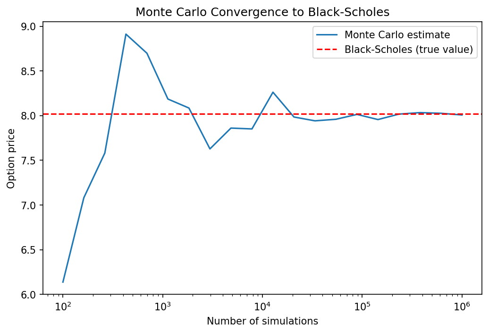
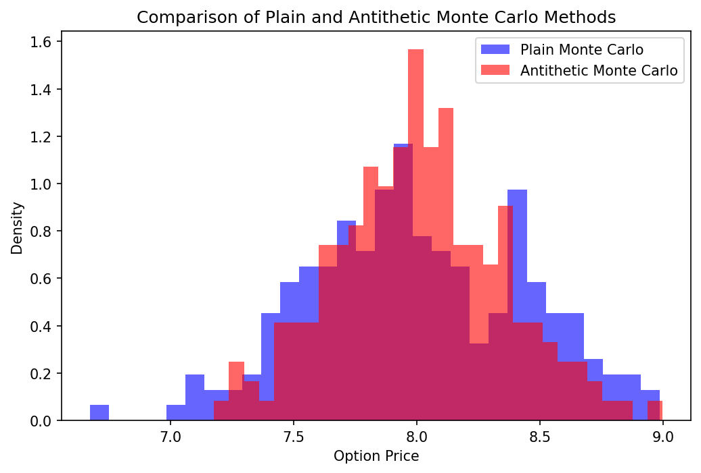

# Monte Carlo Option Pricing Engine

A Python-based options pricing program used to verify Monte Carlo simulation against Black-Scholes pricing. It utilizes antithetic variance reduction, Longstaff-Schwartz least-squares Monte Carlo method for American options, and applies them to live market data.

## Key Findings

- **Convergence:** Monte Carlo call prices converge to Black-Scholes at the expected 1/√n rate. The standard error is about $0.04 at 100,000 simulated paths, and the 95% confidence interval contained the true price in 94.8% of 1,000 independent runs.
- **Variance reduction:** Antithetic variates cut the standard deviation of the price estimates by 23.5% (0.436 to 0.334) at the same number of paths.
- **American options:** LSM prices an American put at $8.74 vs. $7.92 for the European put on the same paths, an early-exercise premium of $0.82. The premium falls steeply from $2.96 at 5% volatility to about $0.88 at 17%, then levels off.
- **Live market data:** On a live NVDA put (strike $145, 86 days to expiry), historical volatility (50.8%) gave a model price of $14.45-$14.59 against a market mid of $17.18. Using implied volatility solved from that mid (60.8%) recovers the mid by construction. This is a calibration rather than an independent test.

## Methods

- Geometric Brownian Motion for risk-neutral stock price simulation
- Black-Scholes pricing formula for both types of options to validate simulations
- Vectorized Monte Carlo simulation (NumPy)
- Path simulation for path-dependent, early-exercise pricing
- Longstaff-Schwartz least-squares Monte Carlo to price American options
- Implied vlatility solved from the bid-ask midpoint with Brent's method
- Live market data (yfinance). Data: current price, historical volatility, live risk-free rate (13-week treasury bill), option chain data

## Results

### Monte Carlo Convergence to Black-Scholes


### Antithetic Variates (Variance Reduction)


### American Put Early Exercise Premium vs. Volatility


## Project Structure

```
README.md
pricing.py
test_pricing.py
requirements.txt
market_snapshot.json

.gitignore
images/
notebooks/
    Monte_Carlo.ipynb
```

## How to run

```bash
pip install -r requirements.txt
```

Open `notebooks/Monte_Carlo.ipynb` in Jupyter or VS Code and run all cells.

To run the automated tests:

```bash
pytest test_pricing.py -v
```

## Future Extensions

- Apply variance reduction to the Longstaff-Schwartz simulation
- Add dividend yield into the model and real-data comparison
- Add path-dependent exotic options (e.g. Asian options)